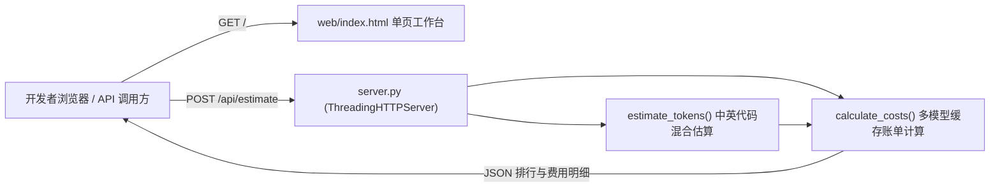

# AI Token 成本估算工作台（AI Token Cost Studio）

零第三方依赖的轻量级 AI Token 分词估算与多模型调用成本对比工作台，专为个人开发者、Agent 工程选型与 API 预算评估打造。

## 核心功能

- **中英代码混合分词估算**：按中文汉字、英文/标识符词元与代码符号分别统计，实时输出单次输入 Token 量。
- **主流大模型账单实时对比**：内置 GLM-4-Flash、DeepSeek-V3/R1、Qwen-Max、GLM-4-Plus、Gemini 2.5 Flash、GPT-4o、Claude 3.7 Sonnet 等模型参考定价，按周期总成本升序排列。
- **缓存命中率敏感度测算**：支持调节 Prompt Cache 命中率（0%–95%）、每日请求量、输出长度与核算天数，一键导出 JSON 测算报告。
- **纯标准库即开即用**：基于 Python 3 标准库实现 HTTP 服务与前端静态托管，无需 `pip install` 即可本地或云端一键运行。

## 系统架构



## 快速启动

```bash
python3 server.py --port 8080
```

启动后访问：`http://127.0.0.1:8080`

运行单元测试：

```bash
python3 -m unittest discover -s tests -v
```

## API 接口

| 方法与路径 | 说明 |
|---|---|
| `GET /` | 返回中文单页估算工作台 |
| `GET /api/health` | 健康检查接口 |
| `GET /api/models` | 获取支持的大模型定价列表 |
| `POST /api/estimate` | 提交 `prompt`、`output_tokens`、`requests_per_day`、`cache_hit_rate`、`days` 返回成本排行 |

## 目录结构

```text
ai-token-calc-studio/
├── server.py            # Python 标准库后端服务与估算核心
├── web/
│   └── index.html       # 交互式前端工作台
├── tests/
│   └── test_server.py   # 单元测试与 HTTP 接口集成测试
└── README.md            # 项目文档与架构说明
```
